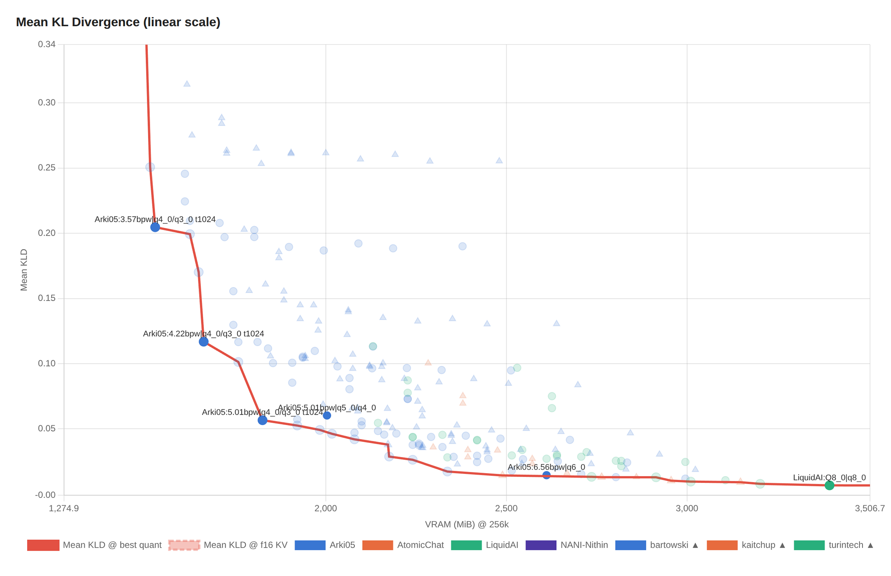
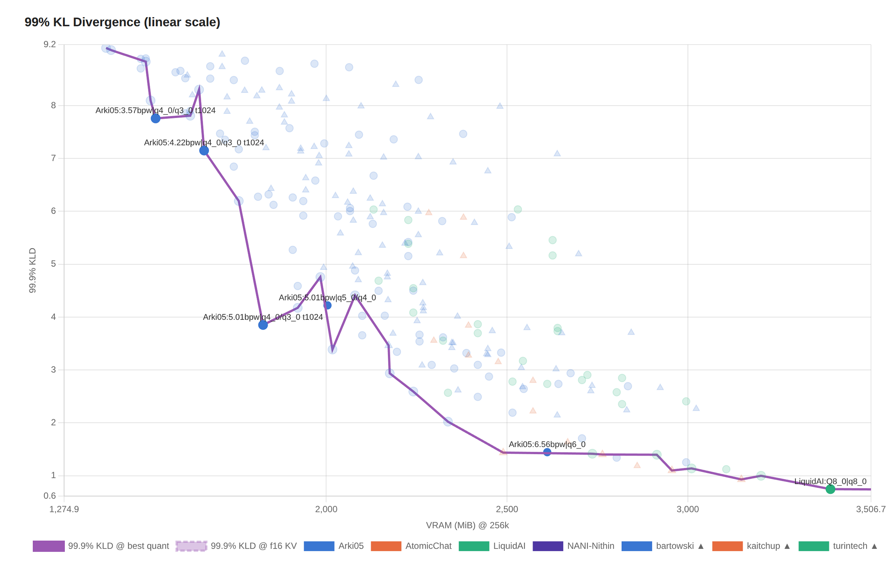
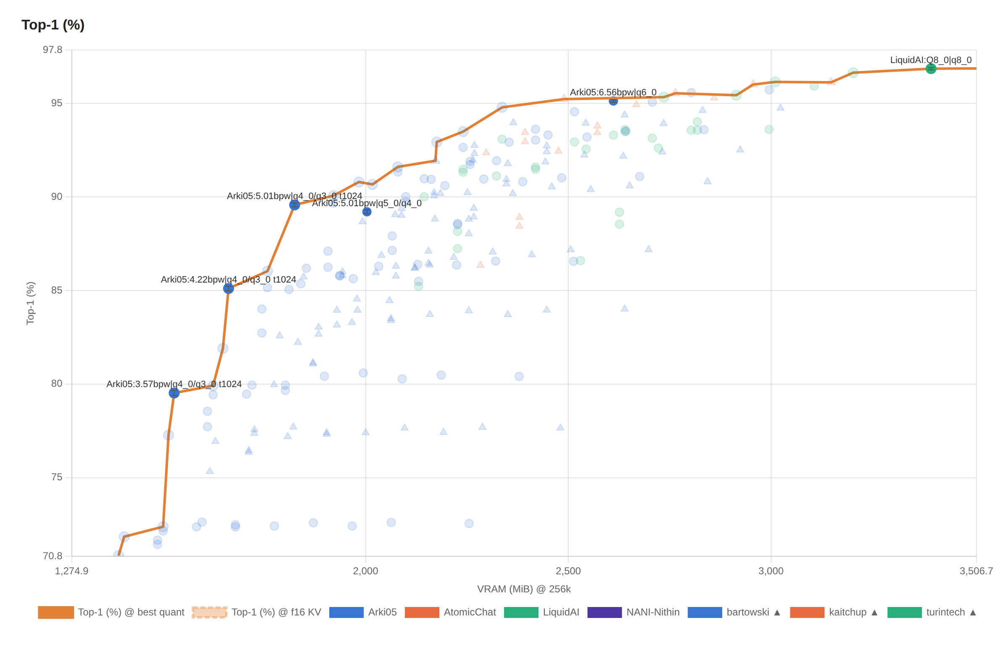
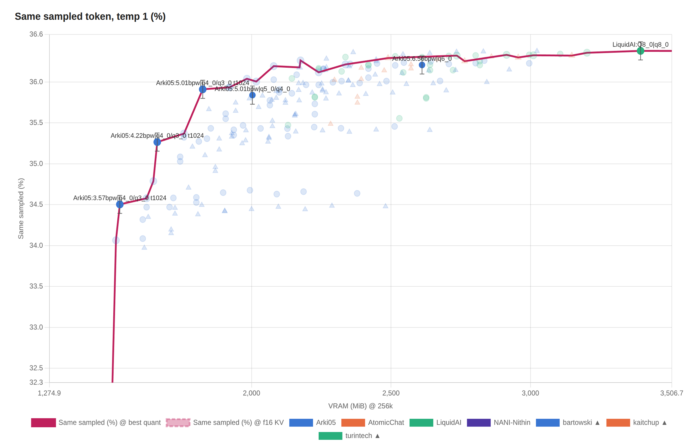
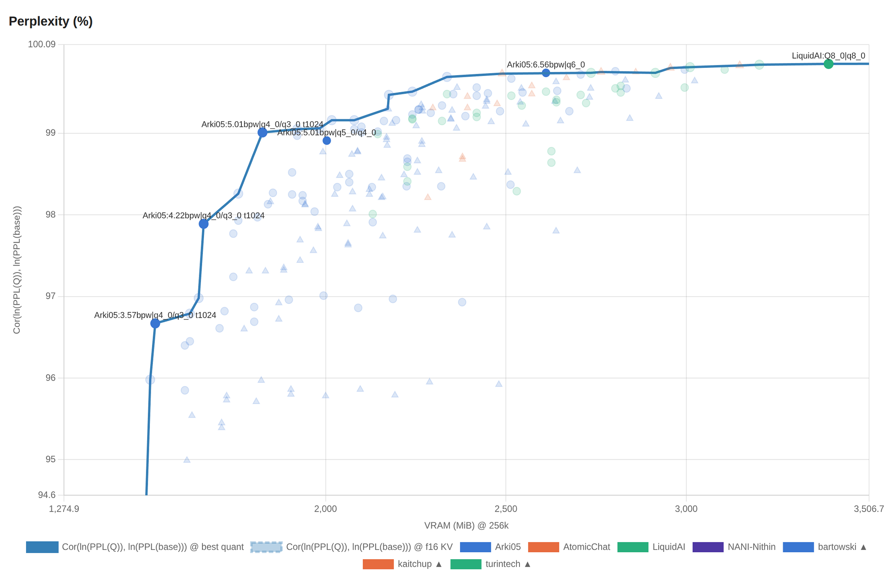

# LFM3-1.7B quantization report

This report measures various quants of [LFM3-1.7B](https://www.liquid.ai/blog/lfm3),
together with KV cache quantization, to determine the least possible degradation at each
size in VRAM.

## Highlights

- **This model fits in 3.7 GiB VRAM** (1.4 GiB weights + 1.2 GiB context + 1.1 GiB
  scratch buffers), with 256k context and no discernible degradation from the
  unquantized version, or **3.1 GiB** with minimal degradation, unlikely to be
  noticeable in benchmarks.
- **It can be crammed down to 1.9 GiB VRAM** with contained degradation and a 128k
  context. Beyond that, quality falls off a cliff.  
- LiquidAI's QAD-Q4_0 scores strictly worse than other quants, but it is a *distilled*
  checkpoint, so its KL divergence against the BF16 model overstates what it actually
  loses.
- KV cache quantisation resists nicely until `k=q5_0 v=q4_0`, after which it falls off a
  cliff.
- [BeeLLaMA.cpp](https://github.com/Anbeeld/beellama.cpp) allows pushing it further to
  `k=q4_0 v=q3_0`, but only after enabling a generous exact tail (`--kv-tail-tokens
  1024`). This suffers from a worst-case scenario, not measurable by KLD, where one
  needs to retrieve important information that's older than the latest tokens. It also
  suffers from very substantial performance degradation (3x slowdown on prefill on CUDA
  RTX 3090). KVarN is not supported due to the model's geometry.

## Best weights/KV cache quants

| Rung | KV (bpw) | Weights (MiB) | KV cache (MiB) @256k | VRAM (MiB) @256k<sup>1</sup> | Mean KLD | 99.9% KLD | Top-1 (%) | Same sampled (%) | Perplexity (%) |
|---|---|---|---|---|---|---|---|---|---|
| LiquidAI:BF16\|f16 | 32.00 | 3,306 | 3,075 | 6,381 | 0.000000 | 0.000048 | 99.993 ± 0.003 | 36.390 ± 0.111 | 99.98 |
| LiquidAI:Q8_0\|q8_0 | 17.00 | 1,761 | 1,634 | 3,395 | 0.006607 | 0.746117 | 96.855 ± 0.061 | 36.381 ± 0.111 | 99.85 |
| Arki05:6.56bpw\|q6_0<sup>2</sup> | 13.00 | 1,361 | 1,250 | 2,611 | 0.014416 | 1.445824 | 95.127 ± 0.075 | 36.209 ± 0.111 | 99.74 |
| Arki05:5.78bpw\|q6_0<sup>2</sup> | 13.00 | 1,200 | 1,250 | 2,450 | 0.026997 | 2.876014 | 93.308 ± 0.087 | 36.227 ± 0.111 | 99.49 |
| Arki05:5.01bpw\|q5_0/q4_0 | 10.00 | 1,042 | 961 | 2,003 | 0.060257 | 4.222301 | 89.205 ± 0.108 | 35.840 ± 0.111 | 98.91 |
| Arki05:4.22bpw\|q4_0/q3_0 t1024<sup>2</sup> | 8.00 | 879 | 783 | 1,662 | 0.116855 | 7.150463 | 85.107 ± 0.124 | 35.266 ± 0.111 | 97.89 |
| Arki05:3.57bpw\|q4_0/q3_0 t1024<sup>2</sup> | 8.00 | 745 | 783 | 1,528 | 0.204673 | 7.757783 | 79.523 ± 0.141 | 34.504 ± 0.110 | 96.67 |
| Arki05:2.97bpw\|q4_0/q3_0 t1024<sup>2</sup> | 8.00 | 621 | 783 | 1,405 | 0.387414 | 9.050275 | 71.843 ± 0.157 | 32.063 ± 0.109 | 93.97 |

<sup>1</sup>Does not include scratch buffers

<sup>2</sup>Requires [BeeLLaMA.cpp](https://github.com/Anbeeld/beellama.cpp)

## Plots

[Click here for an interactive HTML
report](https://htmlpreview.github.io/?https://raw.githubusercontent.com/crusaderky/pixi-llm-recipes/main/perplexity/LFM3-1.7B/report.html)
with the full results. The plots below only highlight the best quants for the sake of
readability.

The Pareto frontier highlights the lowest Mean KLD (across all plots). A few observations:

- all measures are affected by noise, whether they have error bars or not;
- highlighting the Mean KLD frontier on other plots highlights non-linearity on other
  measures, e.g. 99.9% KLD;
- The frontier runs lower than the cherry-picked "best" quants. This is because it
  selects the points with an exact tail (`--kv-tail-tokens 1024`), which however are not
  recommended except in extreme cases, due to poor performance, as explained  above.







**Same sampled token** is my favourite measure. It is from [Quesma's
blog](https://quesma.com/blog/qwen-quantization-quality/), which is conceptually similar
to Top-1, but at temperature=1 instead of temperature=0. It shows a much steeper cliff
and incorporates behaviour seen in both the Mean KLD and the 99% KLD plots.





## Presets

No compromises: indistinguishable from the unquantized model; 3.7 GiB VRAM measured:

```ini

version = 1

[*]
jinja = true
parallel = 1

[LFM3-1.7B]
hf = Arki05/LFM3-1.7B-GGUF:6.56bpw

flash-attn = on
kv-unified = true
ctx-size = 262144
cache-type-k = q6_0  # q8_0 if BeeLLaMA.cpp is not an option
cache-type-v = q6_0  # q5_0 if BeeLLaMA.cpp is not an option

temperature = 0.1
top-k = 50
repeat-penalty = 1.1
```

Minimum size with minimal degradation, full context; 3.0 GiB VRAM measured:

```ini

version = 1

[*]
jinja = true
parallel = 1

[LFM3-1.7B]
hf = Arki05/LFM3-1.7B-GGUF:5.01bpw

flash-attn = on
kv-unified = true
ctx-size = 262144
cache-type-k = q5_0
cache-type-v = q4_0

temperature = 0.1
top-k = 50
repeat-penalty = 1.1
```

Minimum size before the cliff edge; 2.6 GiB VRAM measured, or 1.8 GiB with `ctx-size = 131072`.
Slower; requires BeeLLaMA.cpp:

```ini

version = 1

[*]
jinja = true
parallel = 1

[LFM3-1.7B]
hf = Arki05/LFM3-1.7B-GGUF:3.57bpw

flash-attn = on
kv-unified = true
ctx-size = 262144
cache-type-k = q4_0
cache-type-v = q3_0
kv-tail-tokens = 1024

temperature = 0.1
top-k = 50
repeat-penalty = 1.1
```
